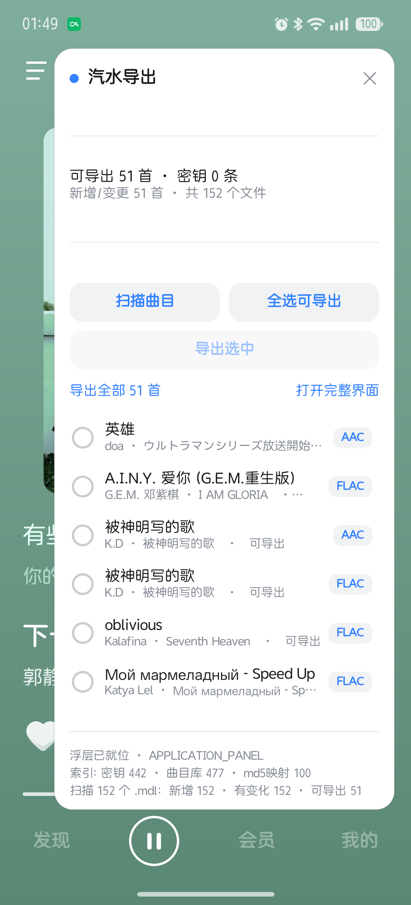

# 汽水导出 · luna-export

`com.luna.music` 的 `.mdl`（CENC / AES-128-CTR）**在手机本地解密**，输出无损 FLAC / M4A，
写入 标题·歌手·专辑·歌词·封面，产出到 `/sdcard/Music/汽水导出/`。

**一个 APK，两种用法**：既是 LSPosed 模块，也是能点开启动的普通应用。
**不主动点导出，就绝不会往 `/sdcard` 写任何歌曲。**

| 宿主内浮层 | 悬浮球 |
|---|---|
|  |  |

---

## 一、包结构

```
com.syh.luna                         ← 一个 APK
├─ assets/xposed_init → com.syh.luna.lsp.MainHook      LSPosed 入口
├─ manifest: xposedmodule / xposeddescription /
│            xposedminversion / xposedscope(com.luna.music)
└─ MainActivity（launcher）                           普通应用入口
```

## 设计原则：不主动点，就绝不落盘

**这是本工具最重要的一条规则。** 自动导出会在你只是正常听歌 / 浏览歌单时也把曲目解密落盘到
`/sdcard`，白占空间。所以：

- LSPosed 模块**没有**「宿主启动自动导出」；
- 独立 App 的「启动时自动增量导出」开关**默认关闭**（截图 `doc/05_默认不自动导出.png`）；
- 打开应用、听歌、浏览——都**不会**产出任何文件；实测确认输出目录在只打开应用时根本不会被创建。

产出文件的唯一途径是你**显式**动作：点「导出选中」，或发出一次导出广播。

### 装上后

| 用法 | 怎么用 | 能力 |
|---|---|---|
| **LSPosed 模块（推荐）** | LSPosed → 模块 → 启用「汽水导出」→ 作用域勾「汽水音乐」→ 重启宿主即可 | ① 在**汽水音乐自己的界面里挂一个悬浮球**，点开就是可勾选的曲目列表，**就地导出，不用切 App**（免 su）② **被动抓密钥**（只读网络响应里的 `spade_a`）③ **被动补元数据**（见下）④ 支持广播手动触发 |
| **普通应用** | 直接点桌面图标 | 用 `su` 读私有目录，独立界面里 扫描 → 勾选 → 导出 |

### 浮层（moonhook 式内嵌）

代码本来就跑在宿主进程里，所以直接往宿主窗口上挂一层 View 就行：

- 挂载点用 `Application.registerActivityLifecycleCallbacks` —— **不 hook 任何混淆类名**，宿主改版也不受影响。
- 窗口用 `TYPE_APPLICATION_PANEL` + 宿主窗口 token。
  **不能用 `TYPE_APPLICATION_OVERLAY`**：权限按 uid 检查，而汽水音乐虽然声明了
  `SYSTEM_ALERT_WINDOW`，appops 实际是 `default`（未授予）。
- 悬浮球图标读自**本模块自己的 APK** 的 `assets/luna-icon.png`。
- **标题栏「汽水导出」那一行是拖动把手**，球和卡片的位置分开记；列表里只有「可导出」的曲目。

> ⚠️ `onActivityResumed` 触发时窗口还没 attach，`getWindowToken()` 必为 null。
> 代码会 `postDelayed` 重试几次再挂载，否则只能退化成 DecorView 兜底。

LSPosed 模式下想手动触发（宿主进程内执行，免 su）：

```bash
adb shell am broadcast -a com.syh.luna.action.EXPORT
# 只导指定的几首（md5 可从导出报告的 "md5" 字段取）
adb shell am broadcast -a com.syh.luna.action.EXPORT --esa md5 1e34a4167f71a451c04039ffbd94f4f6,42eda28b98d9b72f1eecdf5e840d91a6
```

> root 模式下 `su` 落在**应用自己的挂载命名空间**里，那里的 `/data/data` 是个空 stub
> （root 被换成 erofs 模块视图）。代码会自动切到 `/proc/1/root/data/data/com.luna.music`，
> 那才是真数据。这一步在 `Dirs.stage()` 里自动完成。

## 二、界面（Miuix / HyperOS 风格）

大标题 · 白色圆角卡片 · `#3482FF` 主色 · 胶囊按钮 · 圆形勾选 · 内嵌细分隔线 · 支持深色模式。
因为本工程走无 Gradle 手动构建（不引 Compose/androidx），用原生 View + 自绘 drawable 复刻视觉语言，
**零第三方依赖**。

截图见 `doc/`：`05_默认不自动导出.png` `06_曲目列表.png` `02_已选.png` `03_残片状态.png` `04_日志面板.png`

列表每行右侧是「格式徽章 + 状态」：`可导出`(绿) / `已导出`(绿) / `残片`(琥珀) / `缺密钥`(灰) / `跳过`(灰)。
排序把**能操作的排前面**：未导出 → 已导出 → 缺密钥 → 残片 → MV/无效。

第 2 张卡片是「启动时自动增量导出」开关，**默认关闭**，副标题直接写明
「已关闭（推荐）· 只有你主动点『导出选中』才会产出文件」。

## 三、扫描的开销（不用担心「每次打开都很重」）

列表要显示标题/歌手/格式/完整性，但**不需要重读文件内容**：

1. **状态缓存**（`state.json`，指纹 `size:mtime`）：122 个 `.mdl` 的 `(size,mtime)` 全没变
   → 直接用缓存里的元数据渲染列表，**一个字节都不读**。
2. 只有新增/变更的文件才做探针读。
3. 若你把「启动时自动增量导出」打开（默认关），也只导出新增/变更的那几首。

实测（RMX3888，122 个 `.mdl`）：

| 场景 | 耗时 | 读 `.mdl` 内容 |
|---|---|---|
| 首次扫描（122 个） | ~5 s | 122 个 / 1.3 GB |
| 再次扫描（无变更） | 4.6 ~ 5.1 s | **0 个** |
| 手动导出 1 首 | 0.4 s | 1 个 |

> 上面 4~5 s 里绝大部分是 root 模式下的 `su` 暂存拷贝（1.3 GB）+ 索引重建。
> **LSPosed 模式没有暂存这一步**，只有「索引重建 + 列目录」。

## 四、产物落点（设备实测）

Android 11+ 对共享存储里的**非媒体文件**只允许放在 `Download/` 下，
`MediaStore.Downloads` 会拒绝 `Music/` 前缀，所以：

| 内容 | 位置 | 方式 |
|---|---|---|
| 音频 `.flac` / `.m4a` | `/sdcard/Music/汽水导出/` | MediaStore.Audio（进系统媒体库；同目录先删旧条目，重复导出不堆积） |
| 歌词 `.lrc` | 同上，与歌曲同名并排 | 优先直写；不行才退到 `Download/汽水导出/` |
| `_导出报告.json` / `_导出日志.txt` | `/sdcard/Download/汽水导出/` | Downloads 集合，行为稳定可预期 |

日志也可以随时从应用内「▸ 运行日志」面板查看；私有副本在
`adb shell run-as com.syh.luna cat files/last_run.log`。

## 五、关于「缺密钥」

实测数据（122 个 `.mdl`）：

```
flac/compl/KEY    24    flac/partial/KEY    31
aac/compl/KEY     15    aac/partial/KEY     14    ← 可导出 39
aac/compl/NOKEY    2    aac/partial/NOKEY    8
flac/partial/NOKEY 13                        ← 缺密钥 23（音频）
```

**缺密钥的 23 首里，21 首本身就是残片，只有 2 首是「完整但缺密钥」。**

原因：汽水音乐**只在「完整下载」时才把 `encrypt_info` 落盘**。只下了一半的 `.mdl`
连 key 都没拿到，所以「缺密钥」和「残片」是同一件事的两面。

全盘扫描确认：整个 `/data/data/com.luna.music/` 里含 `spade_a` 的文件只有 18 个，
全部落在我们已经读取的三个目录（`cache/NetCacheLoader`、`files/keva`、`databases`）——
390 条密钥就是本地已有的全部，没有漏读的来源。

**解法**：
- 想听哪首，在汽水音乐里**完整下载**它。下载过程必然拿到 key，key 和完整数据一起落盘，
  列表里那一首就会变成「可导出」。
- 那 2 首「完整但缺密钥」的，在 app 里**点开播放一次**即可；LSPosed 模式下 hook 会在
  响应经过时把 `encrypt_info` 直接收进密钥仓（`files/luna_export/keys.json`），不必等它落盘。

> hook 抓密钥是**唯一**在你听歌时默默干的事，而且只写几十 KB 的 keys.json，
> 不产生任何歌曲文件。

## 六、工程结构

```
luna-lsp/
├─ core/src/com/syh/luna/core/     纯 Java · 零依赖 · 桌面与 Android 通用
│   Json / Spade / Mp4 / Cenc / Tags / Index / Scanner / Pipeline
├─ android/src/com/syh/luna/android/
│   Dirs（两种数据源）/ IndexBuilder（sqlite+原文→blob）/ CoverStore（下载+Bitmap 归一化）
│   MediaStoreSink（三级落盘）/ KeyVault（hook 抓到的密钥）/ Exporter（增量编排）
├─ module/src/com/syh/luna/lsp/MainHook.java     LSPosed 入口 + hook 抓密钥
├─ app/  AndroidManifest.xml · assets/xposed_init · res/values/arrays.xml · src/…/MainActivity
├─ cli/src/com/syh/luna/cli/Main.java            桌面验证入口
├─ build-cli.sh   桌面：javac 直编
└─ build-apk.sh   出 APK：aapt2 + javac + d8 + zipalign + apksigner
```

## 七、桌面侧验证（Java 与 Python 逐字节一致）

| 项 | 方法 | 结果 |
|---|---|---|
| Spade 算法 | 官方测试向量 | ✅ `kLwe+…` → `5011945309e6465581fd0d6971c0e002` |
| 分类/完整性 | 110 个 `.mdl` vs Python | ✅ 逐行一致 |
| **解密产物** | SHA256 vs Python 产物 | ✅ **74/74 完全一致** |
| **索引抽取** | `--blobs` 回放 Python 导出的 2093 个 blob | ✅ **逐键逐值 deep-equal**（371/78/84/476） |
| 设备端 | MediaStore + `albumart` 抽取 | ✅ `is_drm=0`、时长/码率正确；封面像素级一致 |

```bash
bash luna-lsp/build-cli.sh
JDK=D:/WorkBuddy/2026-10-09-14-12-52/build/tools/jdk/bin/java.exe
$JDK -cp luna-lsp/out/classes com.syh.luna.cli.Main --report luna/mdl_all
python _luna_dumpblobs.py
$JDK -cp luna-lsp/out/classes com.syh.luna.cli.Main --blobs _blobs.bin --out _java_index.json
```

## 八、踩过的坑（都已修）

| 坑 | 正解 |
|---|---|
| 应用侧 `su` 的挂载命名空间里 `/data/data` 是空 stub | 走 `/proc/1/root/data/data/<pkg>`（`Dirs.stage` 自动探测） |
| `am start` 时 Activity 已在栈顶 → 只走 `onNewIntent`，`onCreate` 不执行 | `singleTop` + `onCreate`/`onNewIntent` 都处理 extras |
| 后台线程读 `session` 字段，而它在 `runOnUiThread` 里赋值 | session 作为参数传入，别读字段 |
| `MediaStore.Downloads` 拒绝 `Music/` 前缀 | 非媒体文件走 `Download/xxx`；音频走 `MediaStore.Audio` |
| 重复导出堆积重复条目 | insert 前按 `DISPLAY_NAME + RELATIVE_PATH LIKE` 先删 |
| `adb push <中文名> /dir/` 报 `Is a directory` | 显式给目标文件名 |
| javac 把**注释里的 `\u`** 也当 unicode 转义 | 源码注释禁写 `\uXXXX` |
| Java 的 `.` 默认不匹配 `\r \u0085 \u2028 \u2029`（Python 只排除 `\n`） | KRC 正则用 `[^\n]*` + `find()/start()==0` |
| `String.format("%05.2f")` 是最短十进制+HALF_UP，CPython 是精确值 half-even | `new BigDecimal(double).setScale(2, HALF_EVEN)` |
| 索引**必须走 SQLite** | 把 `.db` 当原始字节扫会掉到 74/371 |

## 九、GitHub 检索结论

**没有任何现成项目做「汽水音乐本地解密」，LSPosed 模块这块是空白。**

- `yeqiu6080/qishui-decrypt` —— 汽水音乐纯前端 JS 解密（spade 算法来源）
- `jixunmoe/export_music` —— Python「从手机导出解密音乐」，SpadeDecryptor 出处
- `BilMiauz/NcmDumpAndroid` —— 网易云纯 Kotlin 重写 + 元数据 + 内嵌封面，**架构最接近**
- `Merrrrrrrrr/NcmDump-for-Android` —— Shizuku + SAF（无需 root）
- `YiuChoi/Unlock163Music` —— 网易云 Xposed 模块（230★）

针对汽水音乐的 LSPosed 模块（Deer God、moonhook、fuckqishui 等）**只做 VIP 绕过/去广告，不做解密**。

---

## 附录：为什么有些歌名先前是空的（已修）

列表里出现过「歌名是一串 32 位十六进制」的行 —— 那不是乱码，是**查不到元数据时把 md5 文件名当歌名显示**。

根因排查（值得记下来）：

1. 索引里的 476 条标题**零乱码** → 不是编码问题；`Scanner` 对 title/album/artist/lyric 都做了 `fixMojibake`。
2. 缓存里的结构是 `"cache_load_records":{"<vid>|medium|<md5>":1000}`；
   注意 track 对象里 vid 字段叫 **`vid`**（`id` 是另一串数字 id，如 `7166538693606377473`）。
3. **真正的原因**：扫描器原来对每个 blob 只做「从第一个 `{` 解析到串尾」。
   而**宿主 sqlite 的 `-wal`、keva 的 `.sgv` 都是「二进制头尾 + 中间夹 JSON」的容器** ——
   整串解析必然失败，于是这些文件里最新鲜的数据**一条都抽不出来**（`md5映射` 只有 92/156）。
4. 实测：`recent_played` 的 `cached_playable.playableJson` 能解析，但里面的 `cache_load_records`
   是别的歌的；目标映射只在 `weak_net` 的 WAL 与 `cached_queue.sgv` 里，而
   `weak_net_*.db` 主文件仅 4096 字节（表 `future_playable` 0 行），数据全在 379KB 的 WAL 中。
5. `.mdl` 本体不含 vid（`ftypM4A … Lavf58.76.100`，纯容器）；同名 `<md5>.mdlnodeconf`（136B）
   只存 `fkey<md5>`，也不含 vid —— 此路不通。

**修法**：新增 `Json.parsePrefix(text, start)` —— 在指定位置解析**一个** JSON 值并返回消耗长度；
扫描循环改成「解析一个 → 跳到它结束处继续」，而不是「解析到串尾」。
Python 侧同步改成 `json.JSONDecoder().raw_decode`（限额 8MB / 40000 次，防病态输入）。

**效果**：`md5映射 92 → 100`、`密钥 424 → 444`；先前空名的两首恢复为
**被神明写的歌 / K.D**、**Call of Silence / 澤野弘之**。

**再加一层保险**（`BlobStore`）：hook 里把含 `"track"` / `cache_load_records` 的响应体
追加到 `files/luna_export/blobs.bin`，建索引时当额外 blob 一起扫。
宿主的缓存会随 WAL 翻页失效，我们这份长期累积、不过期。

**兜底显示**：万一还是查不到，显示 `未知曲目 · 1d0127ac` 而不是裸奔一串 md5。
